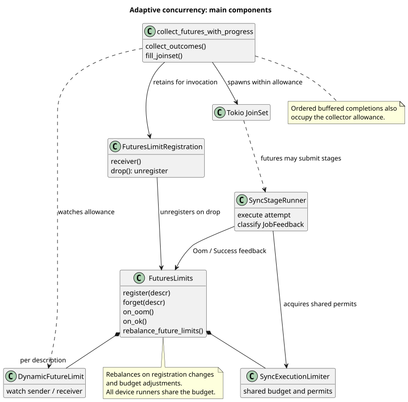
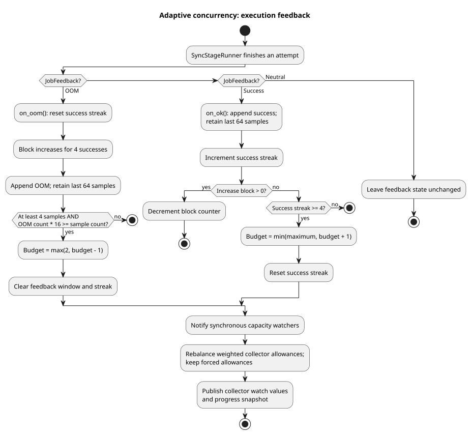
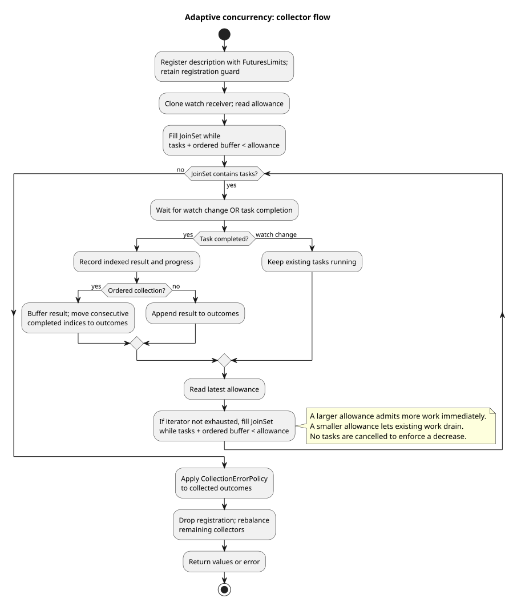

# Adaptive asynchronous concurrency

[`collect_futures_with_progress`](../crates/thoosa_shared/src/collect_futures_with_progress.rs) limits how many futures it starts at once. [`FuturesLimits`](../crates/thoosa_shared/src/futures_limits.rs) adjusts that allowance using feedback from [`SyncStageRunner`](../crates/thoosa_common/src/runner/sync_stage_runner.rs): frequent OOMs reduce parallelism, while successful executions gradually increase it. This reduces the amount of concurrent work holding tensor data during memory pressure.

## Components and shared limits

The collector calls `futures_limits().register(descr)` and retains the returned `FuturesLimitRegistration` until collection finishes. Registration supplies a watch receiver for that description's `DynamicFutureLimit`. Dropping the registration unregisters the invocation and redistributes capacity among the remaining collectors. The best-effort collector uses the same mechanism.

`FuturesLimits` controls two related limits:

- A shared synchronous execution budget, enforced through execution permits across per-device runners. Runner-specific concurrency restrictions and CUDA admission still apply.
- An allowance for each active collector, derived from that shared budget. This controls iterator fan-out; it is not a reservation of synchronous execution permits. An async future can await multiple stages or other collectors.

For shared budget `B`, a collector with weight `w` gets `max(1, floor(B * w / total_weight))`, where `total_weight` sums `registration_count * weight` across all active descriptions. Ordinary descriptions have weight 1, CPU/GPU copy descriptions (`COPY_D2H`, `COPY_H2D`) have weight 2, and `entry` has weight 3. Invocations with the same description share a watch value, but each invocation counts toward the denominator and independently applies that allowance. Registration and unregistration rebalance limits even without execution feedback.

For example, with budget 12, one ordinary collector and one copy collector receive allowances 4 and 8. Adding a second invocation of the ordinary collector changes these to 3 per ordinary invocation and 6 for the copy collector. The minimum of 1 means total collector allowances can exceed the shared budget. `force(descr, limit)` overrides that description's allowance, including during later rebalancing; its registrations still count in the denominator. Shared execution permits continue to bound synchronous work.

## Execution feedback

The runner classifies each submitted attempt as `JobFeedback::Oom`, `Success`, or `Neutral`. It calls `on_oom()` or `on_ok()` after the attempt, respectively; neutral feedback makes no change. Classification includes nested consuming-operation errors. Fatal CUDA recovery paths are neutral. A stage attempt can report OOM even if its enclosing [OOM retry loop](sync_oom.md) later succeeds.

The collector's own `ok` and `err` counters only track progress. They do not call these feedback methods: the feedback comes from execution attempts inside collected futures, rather than from the final collection result. Work that bypasses the runner does not automatically supply feedback through this path.

The current policy in `FuturesLimits` is:

| Feedback | Action |
| --- | --- |
| OOM | Reset the success streak, block increases for the next 4 successes, and append an OOM to the feedback window. On this call only, check whether the window has at least 4 samples and OOMs account for at least 1/16 of them. If so, decrease the shared budget by 1 with a floor of 2, clear the window and success streak, and rebalance collector allowances. |
| Success | Append a success to the window and increment the success streak. If increases are blocked, decrement the block counter and return. Otherwise, after at least 4 consecutive successes, increase the budget by 1 up to its maximum, reset the streak, and rebalance. |
| Neutral | No feedback-window, streak, or limit update. |

The window retains at most 64 OOM/success samples. A success does not check the OOM-rate threshold: for example, an initial OOM followed by three successes leaves the budget unchanged; a subsequent OOM triggers the check and can lower it. The four successes during the increase block count toward the streak, but the fourth still returns early. Thus the earliest increase after an OOM is on the fifth consecutive success. Further increases require four successes each.

By default, the initial shared budget is `available_parallelism()` (falling back to 2 if unavailable), and its maximum is twice the initial budget. Both synchronous capacity notifications and rebalanced collector watch values are published when the budget is adjusted. Rounding, forced allowances, or reaching the budget bounds can leave an individual collector's allowance unchanged.

## Applying a changed allowance

`collect_outcomes` fills a Tokio `JoinSet`, then waits with `tokio::select!` for either a watch update or a task completion. After either event it reads the latest allowance and calls `fill_joinset` if input remains. Watch updates can coalesce; the collector uses the latest value.

`fill_joinset` starts futures while `tasks.len() + completed.len() < limit`:

- In unordered mode, completions go directly into the outcome vector, so only tasks remaining in the `JoinSet` occupy allowance.
- In ordered mode, out-of-order completions stay in a map until preceding indices finish. Those buffered completions also occupy allowance, preventing a slow early future from allowing unlimited look-ahead.

Increasing the allowance can start additional futures on the watch notification, without waiting for a completion. Decreasing it does not cancel existing tasks: the collector waits for occupancy to fall below the new allowance before starting more. For example, lowering 8 to 3 leaves the existing eight tasks to drain; a replacement can start once occupancy reaches 2. Newly spawned children inherit the current `CudaActivityScope`, allowing admitted child work to drain during recovery.

Collection continues through the iterator and drains its tasks before applying `CollectionErrorPolicy` to the outcomes. The collector does not retry a failed future itself; stage retries belong to `OOMHandler`. Progress/ETA reporting and ordered result delivery accompany this scheduling loop but do not determine the adaptive limit.

Editable PlantUML sources: [components](diagrams/async_oom_components.puml), [feedback](diagrams/async_oom_feedback.puml), and [collector flow](diagrams/async_oom_collect.puml).
