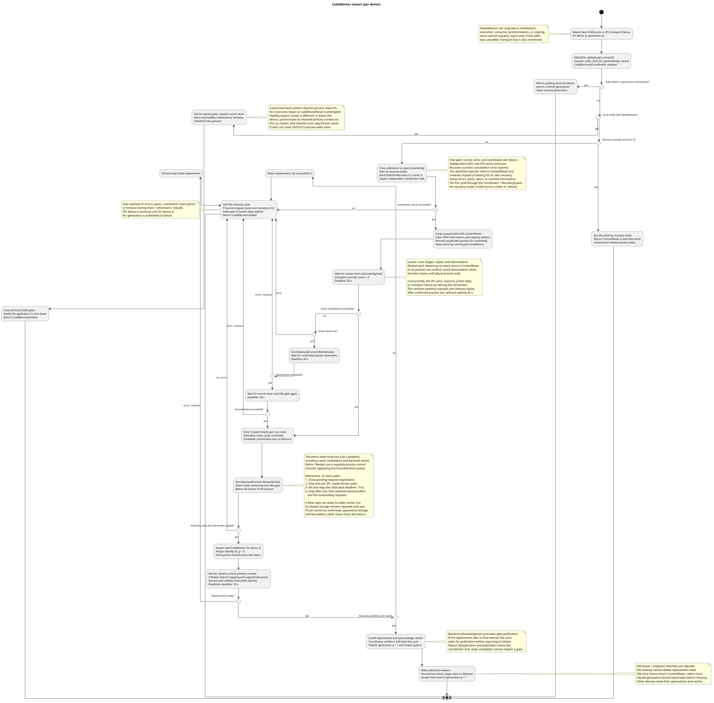

# Local and IPC modes

App can run either in 'local mode' where all cuda operations are executed in the same process or in 'Inter Process Communication (IPC) mode' where cuda operations are executed in a standalone process (CudaWorker) making it possible to restart this process if unrecoverable CUDA error happens.  

[`CudaActorHandle`](../crates/thoosa_common/src/copy_ctx.rs) provides the common interface for tensor copies, execution contexts, and backend recovery. Its `run_stage` helpers prepare input and call a synchronous stage. The mode determines where that stage's GPU work happens; asynchronous orchestration stays in the application process.

`GlobalCtx` creates one actor handle per GPU, using either [`CudaLocalActorHandle`](../crates/thoosa_common/src/copy_ctx.rs) or [`CudaIPCActorHandle`](../crates/thoosa_common/src/ipc/cuda_process.rs).

| | Local | IPC |
| --- | --- | --- |
| GPU execution | Stages run in the application process. | Stage proxies send calls to a separate worker process for each GPU. |
| GPU tensors | The application holds actual tensors. | The worker holds actual tensors; the application holds references containing a tensor key and worker identity. |
| CPU/GPU copies | The local actor uses `CopyCtx` and CUDA streams to copy tensor data. | The IPC actor sends requests over a Unix socket. Tensor data passes through a shared CPU memory arena between the application and worker. |
| Execution context | `init_handle_ctx` acquires a CUDA stream; the context selects it for execution and synchronizes it after the stage runs. | The parent-side context needs no local CUDA stream; execution happens in the worker. |

Both modes use the same [OOM handling loop](oom.md). A recoverable OOM can trigger adjustments and another attempt. Fatal CUDA errors require different recovery: Local mode closes CUDA admission and requests application shutdown because the process's CUDA state may be unusable. IPC mode can retire the failed worker, invalidate that device's cached GPU data, and start a replacement. Worker identities include a generation so old tensor references cannot be used with the replacement worker.

Cached stateless stages and immutable inference models opt into endpoint restoration with `InstanceCache::get_or_try_insert_recreatable_with` and `ProxyStage::proxy_recreatable` (or its input-cloner variant). The cache retains the same proxy across worker generations. The actor retains a serialized initializer while that proxy is owned and installs it once in the replacement worker, on first use. Lazy installation runs within normal stage admission, so model-construction OOMs can use the existing adjustment loop. Initializers must contain configuration or immutable artifact paths, never references to retired worker tensors.

Mutable training stages keep the default owner-managed policy: their async owner rebuilds the session and restores its checkpoint. Endpoint restoration does not replay failed computations or revive old tensor references. Offloaded state from an older generation is discarded when an immutable endpoint is reconstructed. Dropping the last endpoint owner unregisters its initializer even during recovery; ownership tokens prevent delayed cleanup from deleting a replacement with the same key. Missing endpoints and failed CUDA recovery remain errors even when a collector is allowed to skip incompatible data.

The [recovery diagram](diagrams/cuda_worker_restart.svg) shows this distinction and the worker replacement steps.

Editable source: [cuda_worker_restart.puml](diagrams/cuda_worker_restart.puml).
