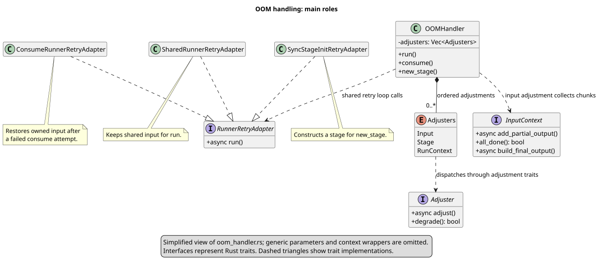

# OOM handling

`OOMHandler` retries GPU work after a recoverable out-of-memory (OOM) error. It can reduce parallel work, free GPU memory, or process input in smaller chunks, depending on the adjusters supplied by the caller. The same retry loop supports shared input (`run`), owned input (`consume`), and stage construction (`new_stage`).

The [activity diagram](diagrams/oom_handler.svg) shows the main steps in [`run_with_runner_impl`](../crates/thoosa_common/src/runner/oom_handler.rs):

1. Create a retry scope. Every attempt uses the same retry token. The scope releases any exclusive retry reservation when the operation finishes or is cancelled; CUDA recovery can also invalidate the scope and stop the operation.
2. Run once without adjustments or an input selector. Return the output on success. Enter the adjustment loop only if the error is a retryable OOM; return other errors immediately.
3. Pick the next adjuster in the caller's list. An input adjuster changes the selector used to fetch a chunk, a stage adjuster changes the task, and a run-context adjuster changes execution settings or frees memory.
4. Apply the adjuster, then run again. If either step returns a retryable OOM, call `degrade` to see whether the current adjuster can try a stronger adjustment. If it can, repeat with that adjuster; otherwise, move to the next one. Return other errors immediately.
5. On a successful retry, handle its output. With an input adjuster, save the partial output in `InputContext`. If more chunks remain, apply the current adjuster again to prepare the next chunk. Once all chunks are done, build and return the final output. Without an input adjuster, return the successful output directly. Errors while collecting or building output are returned immediately.
6. If every adjuster is exhausted, return an error. The loop also stops with an error if it would exceed 100 adjustment steps, counted across all adjusters and chunks.

The [simplified class diagram](diagrams/oom_handler_overview.svg) shows how the main roles fit together. `OOMHandler` holds the ordered adjusters. The shared retry loop calls a `RunnerRetryAdapter` to perform each attempt: one adapter retains shared input, one restores owned input after a failed consume attempt, and one initializes a stage. `Adjusters` dispatches to the configured `Adjuster`; `InputContext` collects chunk results.

`DevicesWrap::wrap` registers storage with runtime residency as part of construction; `wrap_in` binds it to an explicit residency registry. Caching and cache-area branches control reuse and eager cleanup, but are no longer required to make a live handle visible to OOM eviction. Temporary collections own the same managed handles.

`BorrowRef::protect` and `ConsumeData::protect` describe each input's managed handles. The runner holds their device-specific `ResidencyLease`s across attempts and adjustments, and releases them on completion or cancellation. Composite inputs combine their members' leases. Consuming retries acquire new leases after restoring the failed input, so neither cache names nor ID snapshots are needed. Device-reset invalidation ignores these leases and removes failed-device replicas while retaining healthy copies. Taking owned data waits for in-flight residency operations before detaching its registration.

Stage construction accepts only run-context adjusters because there is no input or completed stage to adjust yet. CPU `run` and CPU `new_stage` bypass this retry loop.

See the [full class diagram](diagrams/oom_handler_classes.svg) for context wrappers, trait implementations, and generic types. Editable PlantUML sources: [activity](diagrams/oom_handler.puml), [overview](diagrams/oom_handler_overview.puml), and [full classes](diagrams/oom_handler_classes.puml).
